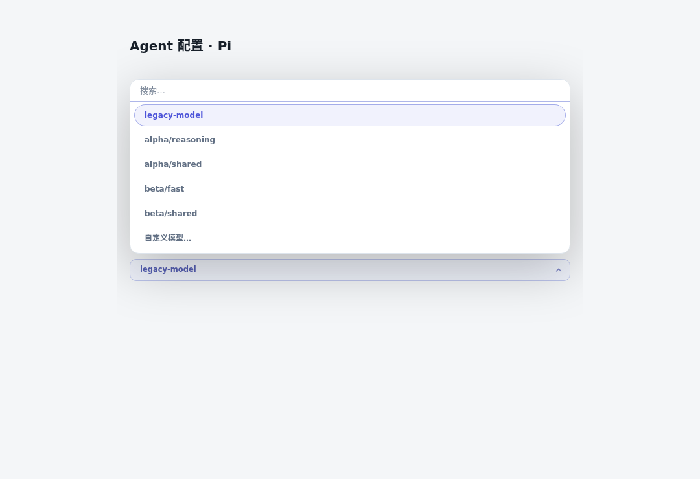
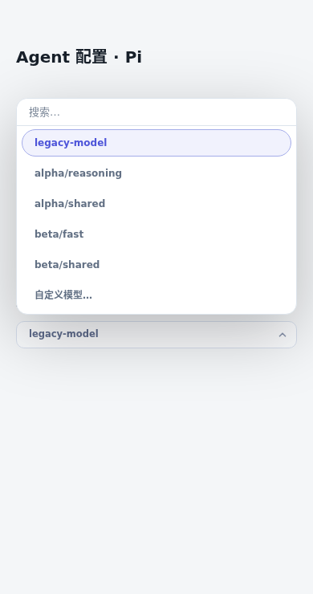
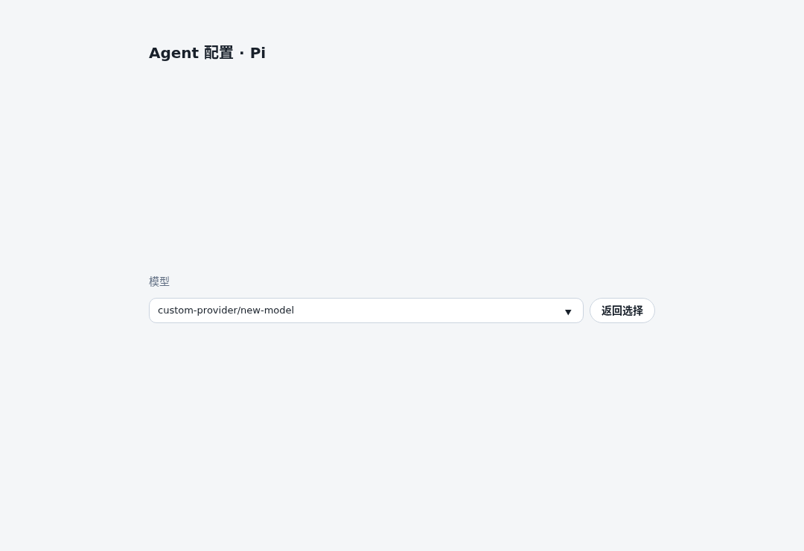

# Pi 模型发现

## 语义与范围

沿用 `GET /api/cli-options/models`，只在用户选择 Pi 时按需探测。结果是目标
runtime 下的**已配置、可枚举模型候选**，不是请求权限或实际调用成功的证明。
返回 `provider/id`，完整标识去重；同名跨 provider 保留。既有裸模型和自定义
模型由现有选择器回显，发现目录不会改写 Bot 配置。

## 原生能力与安全边界

检查了本机安装的 Pi 1.3.0、1.5.0：两者 `--list-models` 均输出 provider、
model、context、max-out、thinking、images 六列表格。它不是纯目录读操作：
启动路径先做迁移、创建 runtime、加载资源，认证解析可能执行 `!command`。
因此不能直接对真实 agent 目录运行它。

实现只读目标目录的 `models.json`、`auth.json`、`models-store.json`，在私有
临时目录生成模型元数据镜像。只保留模型标识/API 类型等白名单字段；headers、
真实凭证、OAuth token、helper 命令和原 settings 不传给子进程。认证信息与
常见 API key/token 环境变量只映射成“已配置”占位符，OAuth 不刷新。
Pi 1.3/1.5 的 provider auth 描述另识别 `HF_TOKEN` 和
`COPILOT_GITHUB_TOKEN`，使用小型显式白名单补齐，也仅传固定占位符。

云认证来源按两版 Pi 的 provider auth 判定在宿主侧检查，然后生成 provider
固定占位符，不传递原始 URI、token、project、location 或 ADC 路径：

| Provider | 可枚举来源 | 不成立的来源 |
| --- | --- | --- |
| Bedrock | 非空 bearer/profile；成对 IAM id + secret；任一容器 relative/full URI；Web Identity 路径来源 | 缺一半 IAM、仅 role ARN、空值或空白环境变量 |
| Vertex | 非空 API key；或显式/目标 HOME 默认 ADC 存在且 project（含 GCLOUD_PROJECT 别名）及 location 非空 | ADC 不存在、project/location 缺项、空值或空白环境变量 |

ADC 只执行与原生相同的存在性检查（F_OK），不打开、读取或解析凭证，不验证
文件内容、调用权限或刷新。相对路径按有效 cwd，前导 `~` 按目标 HOME 展开；
显式缺失路径不会回退默认 ADC。存储的 cloud `api_key.env` 仅按 provider
明确读取的字段参与判定，不整体叠入认证上下文；显式空字段按原生 `??`
规则遮蔽环境 fallback。Bot set/unset 在这些检查之前完成。
畸形存储字段也保留原生语义：`0`、`false` 遮蔽 ambient 后判为未配置，
非零数值、`true`、对象和数组按 truthiness 判定；只有 `null`/缺失才回退。
这些原始值只在宿主侧用于 provider 明确读取的 profile/project/location 等
字段，不整体 overlay、不序列化给子进程；ADC 路径只接受字符串并检查存在性。

子进程使用目标 Bot 或会话所选 executable，但 HOME、Pi agent dir 和 XDG 目录全部
指向镜像，cwd 也是镜像；设置离线、关闭 telemetry，禁用扩展、技能、主题和
提示模板。复用现有受控 exec helper 的短超时及大目录缓冲上限。成功和失败后
均清理镜像；stderr 和私有路径不进入响应。文件读取仅接受有界普通文件。

安装中自带目录使 env/auth-only provider 不依赖 `models.json` 的显式列表；
本地模型缓存也会脱敏后传入。配置 JSON 行注释、BOM 和对象/数组尾逗号按 Pi
语法处理；块注释只允许出现在字符串内，字符串外出现时配置 fail-soft，独立
env/auth 来源仍可枚举。复用已有生产依赖 `yaml` 的 flow lexer 区分字符串与标点，移除
合法尾逗号后由 `JSON.parse` 严格校验；不接受 YAML/JSON5 扩展语法。
未添加或安装依赖。文件大小及普通文件边界不变，非法格式独立 fail-soft。
目录位置复用 `piSettingsPath` 和 Dashboard 的 `botOneShotProbeEnv`，支持全局
env overlay、Bot set/unset、HOME、PI_CODING_AGENT_DIR；后者的 `~/` 展开同时
用于目录发现和既有模型 qualification。
相对 agent dir 统一按有效 cwd 解析。配置页预览 Bot 的默认目录（显式默认、
Oncall 默认，再回退 Bot 工作目录）；新建页无 Bot runtime 时使用当前默认
环境和 cwd。配置页不能代表某个话题的选仓/工作树目录。worker 已向 buildArgs
传递实际会话 workingDir，Pi qualification 使用该目录，而非 Bot 默认或
daemon cwd；已限定 provider 的值不变。
飞书 `/models`、回复菜单和两个提交动作共用 `modelCatalogProbeContext` 的
目录解析：会话优先 live `ds.workingDir`，冷会话保留持久化路径，再读取
adopt 目标路径；无有效会话路径时调用 worker 同用的 `unpinnedSessionWorkingDir`。
无会话的 Bot 默认菜单及配置页也使用该 unpinned 规则，包含实际 HOME fallback；
auto-worktree 默认目录仅为 BASE，不作为尚未 materialize 的活动 cwd，实际工作树
由 live/persisted 路径提供。没有 Bot runtime 的新建页仍用公共层默认 env/cwd。
HOME 故意不落持久状态，此处不写回 HOME。`~` 与空 launch cwd 按 daemon 的
真实 HOME 展开，不把 Bot 注入 env.HOME 误当启动目录。已删除的目录保持原路径，
不静默改用 daemon/Bot/HOME；目录恢复和拒绝启动仍由既有 worker 处理。
TraeX 负载查询使用同一个上下文。adopt 只枚举元数据，不创建 worktree 或启动
会话 worker/后端；Pi 枚举所需的短进程仍只运行在脱敏临时镜像中。

会话 executable 与当前 Bot 默认分开解析：`cliLaunchSnapshot` 的 CLI、wrapper、
launchMode、runtime/path 优先，包括 pending 选择和明确的 null/stock；读取不会
将 pending 置为 resolved。没有选择快照的冻结会话优先自身 runtime，缺失时只按
自身 CLI/path 使用既有 resolver，忽略 stale path shadow；未冻结的同 CLI 兼容
会话按 worker 的 own path、Bot runtime/path 层级解析。未冻结跨 CLI 会话有自身
path 且有效 wrapper/launchMode 可确定时，也可只读解析自身 runtime；不借用另一
CLI 的 Bot executable、descriptor、wrapper 或 launchMode。菜单不修改、补写或修复
持久状态。不同发行版的 executable、runtime cache identity、provider/id 目录和
TraeX load 使用同一个上下文，两种提交白名单仍复用会话目录函数。默认菜单、
配置页继续使用当前 Bot，新建页不借用已有会话或其它 Bot 的 runtime。

runtime 冻结不等于环境冻结。未 selected/未 bound 的 legacy 或冻结会话，包括跨
CLI，会按现有 worker 政策取得 Bot set env；只有 per-session selection 或 instance
binding 跳过 Bot set，但仍应用公共 global/ambient、移除与 envPolicy 规则。共享
只读环境 helper 复用 overlay、worker/child env 过滤与 protected env 脱敏，身份键
锁跟随会话 transport、外部 endpoint 和实际 backend。它不执行身份 wrapper，
不改变 worker 的启动环境或注入新的凭证。Pi 有效 env 仅供宿主解析来源，真正枚举
子进程仍只收到临时 metadata 镜像和 token marker。目录 fallback 是 worker 启动规则，
独立于这个环境边界：跨 CLI 冷会话缺 live/persisted cwd 时也沿用 unpinned 目录
层级，不因为 executable 与 Bot 不同就改用 daemon cwd。快照受到 worker 既有
profile/env/Riff/RPC gate 限制，不一致的 runtime/path、未知形态/状态、实际远端
backend 或远端 CLI 不做本地探测。未冻结跨 CLI 缺自身 path，或真实 worker 会补入另一 CLI 的 Bot
wrapper/launchMode 时仍停止动态探测，不猜测未知形态；这些状态仍可回显既有值，native CLI 无静态目录时
返回空候选。此限制不等同于改变 worker 的兼容补写或启动政策。

后端在确定实际 session CLI/selection 后解析。已有 live `initConfig.backendType`
代表实际运行后端，不因 Bot 变更而重新配对；冷启动按 persisted stamp、Bot、daemon
默认的顺序，复用 `remote-cli-ids` 的配对规则。远端 CLI 保持远端；本地 CLI 遇到
远端配置时回到 daemon 本地默认，daemon 默认本身为远端则回到 pty。同一有效后端
同时控制探测 gate、env overlay、身份键锁和 TraeX load。Bot 默认/配置页仍使用当前
Bot CLI 配对，不借用会话 runtime；不同 CLI 的新建预览不借用该 Bot 的 env/runtime。
这是只读解析，不运行 worker freeze/repair，不写 backend stamp、不启动远端任务。

## 已知边界

- 扩展动态注册的 provider/虚拟模型不加载。执行任意扩展来补齐它们会违反无
  副作用边界，仍可通过现有自定义模型入口配置。
- 脱敏后的认证只能表达 configured-ness。订阅权限、模型 entitlement、凭证
  有效期，以及 provider 专有认证/目录过滤不视为已验证。
- 不做网络模型刷新；使用目标安装的内置目录、显式模型与本地缓存。未来 Pi
  版本改变表格格式或旧版本不支持关闭资源加载参数时，fail-soft 返回空候选，
  旧值及自定义输入仍可用。1.3/1.5 已用真实进程和隔离夹具验证。
- 复用目录服务的成功 TTL/in-flight 缓存；空结果和失败不缓存。env 哈希使用
  实际探测 env 和有效 cwd，包括未显式传入的新建页请求，避免目录跨环境混用。
  配置文件改动在成功缓存 TTL 到期后生效。

## 影响面

Pi 新增 env-aware `detectModels`。公共适配器接口和 exec helper 只增加可选
env/cwd 输入，其它现有调用保持不变；公共目录服务将同一个有效 env/cwd 用于缓存
身份与探测。Codex 的 capabilities 路径、visibility 过滤、动态替代静态语义不改。

配置页、新建页和群默认模型复用原有选择器与端点，无平行后端。PTY/Tmux 只在
Pi 的 agent-dir 带 `~/` 或相对路径时共享路径展开修正；不改变输入/后端/会话
持久状态。PTY 直接传递 cwd，Tmux 壳包装会 cd 回会话目录；已有 live adopt
不重新启动或改写运行中的模型。scratch 初次启动沿用同一目录内容的镜像；
配置页不探测运行中 sandbox 的私有后续变更。
oh-my-pi/ebsd 未接入发现模块，未自动纳入功能范围。实现使用 Node 的路径、文件
和 execFile API，没有 Linux 专有 shell 命令；Linux 已实测，macOS 未实机运行。

## 验证材料

真实浏览器夹具：原生 Pi 1.5.0 → adapter → 公共目录服务 → 现有 frontend fetch
→ 真实 `ModelPickerField` 和 Dashboard CSS。合成配置不使用真实凭证。验证目录
选值、自定义输入和 390px 窄屏无横向溢出，浏览器无 pageerror。

定向测试：`timeout 120s bun run test` 后接 `pi-model-catalog`、`pi-model`、
`model-catalog`、`model-catalog-json`、`dashboard-cli-options-models`、
`dashboard-bot-defaults-model-picker`、`codex-service-tier-catalog`、
`codex-coco-detect-models`、`traex-detect-models`、`opencode-mimocode-detect-models`、
`static-model-choices-no-process`、`pi-family-content`、`group-default-models`、
`cli-model-choices`、`test-hygiene`，以及补改的 `pi-model-launch-cwd`。
云来源补改增加 `pi-cloud-model-catalog`，覆盖正反矩阵、Bot set/unset、目标
HOME/cwd 与缓存失败重试/到期。两版 Pi 的合成原生对照断言完整 provider/id
集合及 stderr 解析失败信号，不依赖固定模型数量或输出标题。
原候选 15 文件 234/234 通过；云来源补改后 17 文件 319/319 通过。
Pi 1.3/1.5 每版对照 60 种云来源、9 种语法、28 组 Bot env 覆盖及 3 组
HOME/cwd，共 200 组完整目录集合对照通过；16 种隔离守卫变异均触发对应
行为断言失败。旧 token/JSONC/cwd 原生对照也重新通过。
飞书 cwd 与畸形字段补改后，19 文件 518/518 通过；其中真实命令、回复菜单、
卡片提交覆盖 PTY/Tmux 的 daemon/Bot/session 三个不同目录与跨 provider 同名
模型，实际会话模型被接受，daemon/Bot 错误目录模型被拒，群默认卡使用 Bot
目录。另有 TraeX 共用菜单、提交与默认负载 cwd 回归。
云来源扩展到每版 88 组（新增 28 组非字符串字段），连同语法、Bot overlay 与
HOME/cwd 共 256 组完整集合对照通过；两版各验证 PTY/Tmux 飞书目录和菜单渲染，
4 组均与原生 session/default 目录一致。新增 5 种隔离变异均以对应行为断言
失败退出，不以超时、模块加载或其它基础设施错误作为咬红证据。
现有 adopt 目标、adopt 会话和模型固定冷恢复另跑 3 文件 23/23，通过既有
测试围栏，不连接真实 tmux/systemd。两轮定向回归共 22 文件 541 项通过。
原有 36 项 Pi1.3/1.5 原生对照也在新候选上重新通过，旧修正保持。
HOME 未持久化补改后，26 文件 619/619 通过，含既有目录继承、auto-worktree、
adopt/冷恢复和非 Pi 回归。新增共用上下文测试覆盖两种 CLI、两种后端及 10 类
目录状态，共 40 个组合；真实卡片测试扩展为两后端各 5 类状态，同时验证
`reply_model_pick`/`session_model_pick` 的接受、拒绝和菜单不落盘行为。
两版 Pi 各跑 PTY/Tmux、10 类 cwd 场景，共 40 组 session/default 原生完整集合
及菜单对照，另 4 组已删除目录只读检查通过；新增 6 项隔离变异全部以对应
AssertionError 退出，包含 live、persisted、fallback 与探测/负载传播。
上述 HOME 补改后的候选重新跑两版各 88 组云来源、9 组语法、28 组 Bot overlay
及 3 组 HOME/cwd，共 256 组完整集合对照通过，保留此前认证与语法修正。
冻结 runtime 补改后，31 文件 934/934 通过。本轮新增 49 项行为测试：34 项
只读 probe 与真实 worker 配置解析对照、环境/stock/不可探测状态及跨 CLI 冷目录
检查，15 项真实选择器、菜单、双提交、缓存与 TraeX load 检查。覆盖同 CLI
换路径、Bot 换 CLI、snapshot 有/无/pending、旧路径/缺 shadow 和 PTY/Tmux
配置；提交与持久化/restart/delivery 使用 mock，不是 live 生命周期验证。
私有 fake executable/PATH 的 8 组 worker/菜单反例全部转绿，14 项隔离变异
全部以业务 AssertionError 失败，包含冻结 executable、adapter 传播、cache
identity、TraeX load、可探测 gate、跨 CLI env、stock null 及旧 cwd 守卫。
两版真实 Pi executable 各跑当前 Bot Pi/Claude、PTY/Tmux、snapshot 有/无、
live/HOME 冷目录组合，共 32 组 worker 配置、完整目录和卡片对照通过；当前
Bot/PATH 的私有 fake executable 输出不同模型，证明会话未改查这些 executable。
两版 Pi 的旧 40 组 cwd 原生集合与 4 组 gone 检查、256 组认证/语法集合对照
继续通过；本轮没有加载任意真实认证 helper、扩展或连接云 API。
跨 CLI 合同补改后，新增 72 项行为用例，36 文件 1099/1099 通过。新增场景
覆盖有效 legacy 自身路径、未 selected/未 bound 的 Bot set env、snapshot/binding
跳过 set、global/removal/strict、transport 身份键锁、live backend 和 protected
redaction。前述历史跨 CLI env 排除断言已按现有 worker launch 合同更新。
会话命令、回复菜单和双提交验证完整 provider/id、正确接受/错误拒绝及只读身份；
子进程捕获验证无源路径、原始 token 或 helper 泄漏。两版 Pi 共 96 组
same/cross CLI、PTY/Tmux、legacy/frozen/snapshot/binding、set/unset/strict
原生目录集合对照通过，旧 cwd、冻结 runtime 与云/JSONC/token 对照也重新通过。
覆盖 token Bot set/unset、JSONC 正反例、daemon/Bot/session 不同 cwd、缓存隔离、
启动 qualification 和真实后端参数/壳包装。守卫变异仅在隔离副本运行。
不按源码文本断言，未运行全量测试，未统计覆盖率。截图保留原浏览器夹具证据，
本次没有修改样式或选择器控件；这些截图不是 live 验收。

构建用 `bun run build`；本机缺少 typescript-native，因此脚本自动回退 TypeScript
5.9，没有在共享依赖目录安装。Pi 原生探针和浏览器夹具均经
`bun scripts/fenced-run.ts -- bun <探针路径>` 运行。

基线与完整 diff 范围随候选回报。未部署到 live，未改
全局 botmux 指向，未重启 fleet；独立评审、受控部署与界面验收由后续流程安排。

### Dashboard HTTP 配置解析

模型与 availability 两个只读 HTTP 入口共用本地配置解析：已注册 Bot 配置优先；
独立 Dashboard 未注册 Bot 时，单独读取磁盘配置，不让 registry 的异常跳过回退。
这不注册 Bot、不启动 worker、不改变配置/会话持久状态，也不改变公共探测规则。

不传 `bot` 仍是 CLI 预览，按现有 ambient 规则探测；显式目标无法解析不再冒充
ambient 成功。未知 Bot 返回 HTTP 404 `{ok:false,error:"bot_not_found"}`；配置不可读、
缺失或格式错误返回 HTTP 503 `{ok:false,error:"bot_config_unavailable"}`，不返回私有
路径或读取错误细节。未知 selection key 的既有 HTTP 400 保持优先。这是对旧入口
错误情况下 HTTP 200 的有意收紧，客户端既有失败软降级保留旧值/自定义输入。

真实 HTTP 集成回归执行完整 Dashboard 路由，验证 registry 与磁盘冲突、相对模型
目录、Bot/daemon 不同 cwd、runtime/env 来源、完整 provider/id 和配置只读；
不以 helper 调用或 mock HTTP 模型响应代替入口验证。隔离 SPA 复验截图作为外部
证据保留，不覆盖此前截图；生产飞书 UI 与云模型调用仍需后续明确授权与验收。
